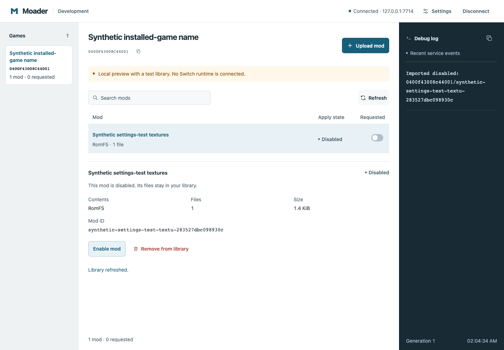

# Moader

Moader manages your Switch 2 mod library from the console or a browser on the same network. Add mods, choose which ones to enable, and check what the game needs to reload.

The console app opens from **hbmenu**. The resident plugin keeps the browser and library available when you close the app. The filesystem runtime makes your enabled mods available to games for the current boot.

## Get started

1. [Download Moader and choose a setup method](docs/INSTALLATION.md).
2. [Pair a browser with your Switch](docs/USAGE.md#connect-a-browser).
3. [Install a community mod from the Store](docs/USAGE.md#community-mods) or [upload your own ZIP](docs/USAGE.md#upload-your-first-mod).

| Download | What's inside |
| --- | --- |
| [Moader v3.5.0 app and plugin](https://github.com/H644b/Moader/releases/download/v3.5.0/Moader-v3.5.0.zip) | Copy both files to SD for the community Store on your console and in the paired browser. |
| [v3.0.0 backend kit](https://github.com/H644b/Moader/releases/download/v3.0.0/Moader-backend-v3.0.0.zip) | For first-time backend setup. After setup, install the v3.5.0 app and plugin above. |

[v3.5.0 release notes and checksums](https://github.com/H644b/Moader/releases/tag/v3.5.0) · [Browse the community catalog](https://moader.timsfun.com/)

| Console app | Browser |
| --- | --- |
|  |  |

[About the example libraries](docs/images/README.md)

[Supported mod formats](docs/USAGE.md#upload-your-first-mod) · [Troubleshooting](docs/TROUBLESHOOTING.md) · [Test results](docs/VALIDATION.md) · [Build from source](docs/BUILDING.md) · [Contribute](CONTRIBUTING.md)

Moader is licensed under [GPL-2.0-only](LICENSE). See [third-party notices](THIRD_PARTY.md).
