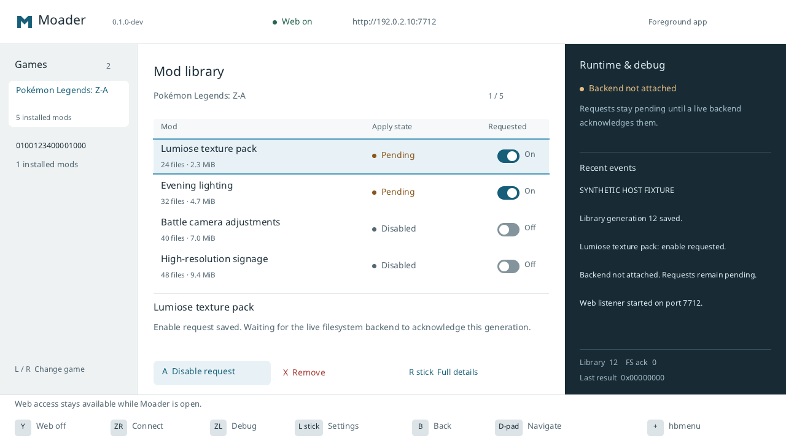

# Moader

Manage Switch 2 mods from your controller or a browser.

## Get started

1. [Install Moader](docs/GETTING_STARTED.md) or open the [SmileBASIC guide](docs/SMILEBASIC.md).
2. [Pair your phone or computer](docs/USAGE.md#connect-a-browser).
3. [Add your first mod](docs/USAGE.md#upload-your-first-mod).

[Downloads](https://github.com/H644b/Moader/releases/latest) · [Controls and settings](docs/CONTROLS.md) · [Fix a problem](docs/TROUBLESHOOTING.md)

| Console app | Browser |
| --- | --- |
|  |  |

[About the example libraries in these images](docs/images/README.md)

[Developer docs](docs/dev/README.md) · [Contribute](CONTRIBUTING.md)

Moader is licensed under [GPL-2.0-only](LICENSE). See [third-party notices](THIRD_PARTY.md).
