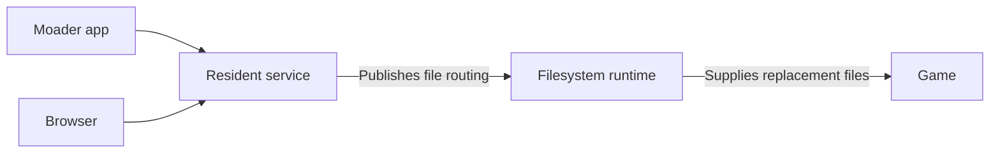

# How Moader works

| Component | Job | How long it runs |
| --- | --- | --- |
| Console app (`Moader.nro`) | Controller interface and foreground library/browser access | While the app is open |
| Resident service (`moader.nso`) | Manages the shared library and serves the browser interface on the Switch | Independently of the app and game, until reboot |
| Filesystem runtime (FS) | Applies supported mod files to game reads | Until reboot |

Copying the app or plugin to SD puts the file in place. [Backend setup](GETTING_STARTED.md#start-the-backend-for-this-boot) starts the resident service and installs FS routing. A [compatible service reload](PLUGIN_RELOAD.md) replaces the resident while the filesystem runtime keeps running.

## From an enable request to a visible change

1. Moader saves the requested state and writes a list of file replacements to SD.
2. The filesystem runtime checks that list and sends an acknowledgement for the current service and list version.
3. The game reads the affected file. It may already have a cached asset, an older file or mount open, or code loaded from startup.

The apply state shows where the request stands. For example, **Pending** means the acknowledgement is outstanding. **Reopen content** means the routing was accepted and the game still needs to read the file.

## What can change while a game runs?

| Payload | When the game can use it |
| --- | --- |
| Existing loose RomFS file replaced with the same size | On a later read. Reload the content if the asset is cached. |
| New or resized RomFS file, or full image | After the game opens a fresh view of the files. Relaunch if the game keeps the old view. |
| ExeFS file, module, image or binary IPS patch | After a game relaunch, including after disabling or removing it. |

A file already open can keep using its earlier routing. Moader keeps removed payloads on SD so those files can finish reading. See [supported mod layouts](USAGE.md#upload-your-first-mod) and [test results](VALIDATION.md).

## Native diagnostics

Press **ZL** or open the browser debug panel. Library events show requests. Native diagnostics show runtime operations and can confirm a replacement read. The app and browser read completed report and event snapshots while the runtime writes new events separately.

## Lifetimes, reboot and service failures

The resident normally keeps serving the browser when you exit the Moader app or close a game. If a game reports an error and the service is still reachable, disable the suspected mod and relaunch the game. Recovery after a forced game error remains untested.

After a console reboot, the library and preferences remain on SD. Set up the backend again for that boot.
