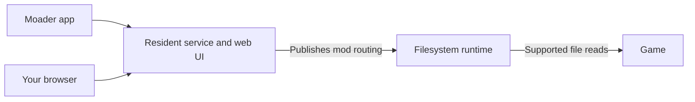

# How Moader works

Moader has three parts. You normally interact with the first two; the third makes game reads follow your mod choices.

| Component | Job | Lifetime |
| --- | --- | --- |
| Console app, `Moader.nro` | Controller workbench, settings and debug display | While the app is open |
| Resident service, `moader.nso` | Owns the shared library and serves the browser interface | Independently of the app/game, for the installed boot |
| Filesystem runtime | Redirects supported game reads and acknowledges accepted routing | In the installed FS environment, until reboot |

The browser assets are hosted on the Switch. There is no cloud service in the management path. If the resident service is absent, the app can host a foreground library/web interface instead; closing that app closes its listener. Copying the NRO alone does not install the resident process or FS hooks. See [Installation](INSTALLATION.md).

## A request is not yet a game effect

When you enable, disable or remove a mod, the service saves the requested state and publishes a checked catalogue on SD. The filesystem runtime acknowledges the catalogue with a matching service identity and generation. This lets both interfaces distinguish a saved request from routing the backend has actually accepted.

An acknowledgement establishes accepted routing. The game still has to read the relevant content. It may already have a texture in memory, retain an older file/mount, or have loaded an executable at launch. Moader therefore shows an apply state rather than treating every successful click as an immediate visible change.

## What can change while a game runs?

| Change | Apply requirement |
| --- | --- |
| Existing loose RomFS file, same size | Later reads can use the new routing; cached assets may need a scene/content reload |
| Added path or resized file | Requires fresh content/mount geometry; a game relaunch may be needed |
| Full RomFS/PFS0 image or a mount with rebuilt geometry | Existing views can remain pinned until a new mount |
| ExeFS module or binary IPS patch | Relaunch the game; disabling cannot unload code already in memory |

Unsupported geometry does not become a promise of live application. Read the per-mod detail text and reopen/relaunch as indicated. Text IPSwitch compilation is not included in this release.

For safe object lifetimes, open reads/files can retain their previous routing while newer reads use a newer catalogue. Disabling does not retroactively change a read already in progress. Recoverable removal keeps source payload paths available for those older objects; removal from the library is not disk deletion.

## Native diagnostics

The app and browser show native report/event output from closed, bounded snapshots. A separate retained writer log can remain open while readers inspect those snapshots. Fresh routing rows let you correlate a request with actual native processing rather than relying on a cached header.

Use **ZL** in the app or the browser debug panel. Shared settings and requested-state events are useful context, but native operations, acknowledged routing and visible game behavior remain separate observations.

## Original hardware validation

Real-console testing of the original app/resident pair covered resident HTTP, browser ZIP management, shared settings, controller controls and native debug display in both interfaces. The rebuilt v0.1.0-dev.3 pair fixes ZIP decoding and has host validation only; these console checks have not been repeated on it. HEN and native FS runtime bytes are unchanged.

A bounded Mario Kart 8 Deluxe test used **one equal-sized existing course-preview texture**. In the same running game process, the observed sequence was:

| Request | Observed image |
| --- | --- |
| Disabled baseline | Usual candy-track preview |
| Enable | Distinct replacement preview |
| Disable | Candy preview restored |
| Re-enable | Replacement preview returned |
| Remove while enabled | Candy preview restored; managed library empty |

The game needed **race → pause/quit to the main menu → VS Race/course selection** to reload that cached preview. Returning only to character selection did not visibly refresh it. No game close or console reboot was needed for those changes. Native routing and source-read observations supported the user-visible result.

The game was then fully closed and reopened normally without rebooting the console. All **31/31 authenticated HTTP observations** across the bounded close/reopen interval remained available with connected, current routing and an empty managed library.

This validates the described fixture/workflow, not universal hot swapping or every game/mod type. No original-game whole-file hash comparison or same-open-file byte-for-byte original/mod/original sequence is claimed. Game assets and the test replacement are not distributed with Moader. See the [public validation summary](VALIDATION.md) for the complete tested scope and host/hardware distinction.

## Lifetimes, reboot and crashes

The resident service is a separate process with its own service/filesystem sessions. Closing the console app, closing the browser or normally relaunching the game does not intentionally stop it. The running backend is **until reboot**; saved mods/preferences remain on SD, but the next boot needs the supported backend setup again. Copying a new NSO onto SD does not hot-reload the current process.

A normal **game-only** software error is expected to leave the resident service and FS runtime available: disable/remove the offending mod in the browser, then relaunch the game. **Deliberate game-crash recovery was not tested.** A crash in FS, HEN or the system, or a console reboot, can invalidate the backend context and require fresh setup. Process separation is not a guarantee that every malformed mod is isolated from privileged filesystem code.

## For contributors

The catalogue/receipt checks, retained routing objects and snapshot diagnostics have host regression coverage, including sanitizer tests. Host checks complement the bounded hardware validation above; they do not establish compatibility with an untested console environment or mod.

See [Building](BUILDING.md) for the toolchain/tests and [Maintaining](MAINTAINING.md) for backend/release maintenance. End users can use the matched precompiled [release downloads](https://github.com/H644b/Moader/releases/tag/v0.1.1).

The v0.1.1 release includes the later cache, game-card and reload changes. Its exact new app/resident build has host validation only, and the shared game/host-exit path still has a reproduced system fatal. See [Validation](VALIDATION.md) and [v0.1.1 notes](releases/v0.1.1.md).
