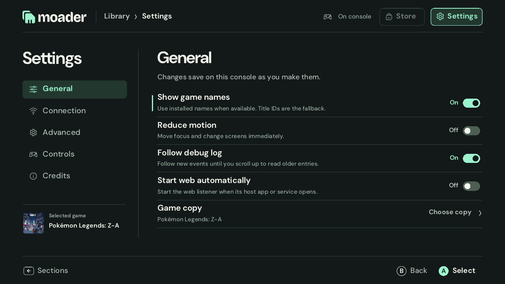

# Use Moader

Moader keeps the same saved library and preferences in its console app and browser interface. For installation and the distinction between foreground and resident mode, start with [Installation](INSTALLATION.md).

## Controller controls

These library actions apply to the selected mod. Settings and diagnostic screens use their own on-screen prompts.

| Control | Action |
| --- | --- |
| D-pad | Navigate games, mods and menus |
| L / R | Change game |
| A | Enable/disable the selected mod; activate a menu item |
| X, then X | Confirm recoverable removal of the selected mod |
| B | Back or cancel |
| Y | Toggle the web listener; reconnect when disconnected |
| ZR | Show the web address and pairing code |
| ZL | Open/close the debug view |
| Left-stick press | Settings |
| Right-stick press | Full mod details |
| Minus | Save an app screenshot |
| + | Return to hbmenu |

In **resident mode**, + closes the app while the independent service keeps the web interface available. In **foreground mode**, closing the app also stops its listener.

## Connect a browser

1. Put the Switch and browser device on the same local network.
2. Open Moader and press **Y** if the web listener is off.
3. Press **ZR** and open the exact address shown. With the default port, the form is `http://YOUR_SWITCH_IP:7712`.
4. Enter all **six digits** from the Switch, including any leading zeros.

The Switch serves the HTML, styles, scripts and API. Pairing needs no cloud account. Keep the pairing code private and use this plain-HTTP interface on a trusted local network. Several incorrect attempts temporarily lock pairing; wait before trying the code again.

## Upload your first mod

In the browser, choose **Upload mod**, select a ZIP, enter the correct **Game Title ID** and a name, then upload. Games appear in the left rail when they have imported mods. New mods are imported **disabled**, so review their contents and apply requirements before enabling.

Use the game's real 16-character hexadecimal Title ID. `YOUR_16_DIGIT_TITLE_ID` below is a placeholder to replace, not a value to paste into the form. A display name does not change which Title ID receives the mod.

```text
Upload form
  Game Title ID: YOUR_16_DIGIT_TITLE_ID
  Mod name: My example mod

my-mod.zip
└── romfs/
    └── path/
        └── from-the-game/
            └── example.bin
```

The path inside `romfs/` must match the path used by the game. One enclosing folder around the mod is accepted. Use mods for the correct game/version; importing a ZIP does not establish that its files are compatible.

Supported payload roots include `romfs/`, `exefs/`, `exefs_patches/` with binary `.ips` patches, `romfs.bin` and `exefs.nsp`. Text IPSwitch scripts are not compiled by this release. ZIPs are limited to **128 MiB**, with at most **64 MiB per expanded file** and **256 MiB expanded total**. Links, unsafe paths and conflicting enabled replacements are rejected.

## SD card layout

Moader stores each mod separately under `/moader/library/`, grouped by the game's Title ID. Browser uploads create this structure automatically:

```text
/moader/library/YOUR_16_DIGIT_TITLE_ID/
├── mod1/
│   ├── mod.meta                 optional display name, plain text
│   └── romfs/
│       └── [original game folders and replacement files]
└── mod2/
    └── romfs/
        └── [original game folders and replacement files]
```

For manual copies, use a lowercase Title ID and mod folder names of at most 48 characters containing only lowercase letters, digits, `-` or `_`. Spell the payload folder **`romfs`** in lowercase. `exefs/`, `exefs_patches/`, `romfs.bin` and `exefs.nsp` go at the same level as `romfs/` inside the mod folder.

Choose **Refresh** in the browser after a manual SD copy; the resident also rescans in its background loop. Enable copied mods through Moader. Let the app manage its state files; do not move, edit or delete an enabled payload while a game is using it. Recoverable removal retains payloads for older open filesystem objects, as described below.

## Enable, disable and remove

Select a mod and switch its requested state, or press **A** in the app. Read the apply state and detail text afterward:

| State | What to do |
| --- | --- |
| Disabled | The mod is not requested; previously cached/loaded content may still need reopening |
| Pending | The request is saved, but matching runtime acknowledgement is still outstanding |
| Reopen content | Routing is accepted; make the game read/reopen the relevant content |
| Relaunch game | Close and reopen the game for executable or other launch-time changes |
| Error | Read the detail/debug message before trying another change |
| Game unavailable | Insert the matching cartridge, select the actual digital copy, or resolve the stated verification problem |

Same-sized replacements of existing loose RomFS files can affect later reads in a running game. That does not flush the game's asset cache. In the tested MK8 preview, returning only to character selection was insufficient; **start a race → pause/quit to the main menu → VS Race/course selection** refreshed the image without closing the game.

To remove a mod in the browser, select **Remove from library**, then confirm **Remove mod**. On the controller, use **X**, then **X** again. Removal updates the library and requested routing. Its payload is retained for recovery and older open filesystem objects; it is **not a physical disk purge**. Loaded executable changes require a game relaunch even after disable/removal.

## Game copy and cartridges

Select the game, open **Settings → Game copy**, and choose the copy you actually use. The setting saves immediately and is shared by both interfaces.

- **Unspecified / Check inserted card:** the conservative default. A matching inserted card and available base Program are required.
- **Cartridge / Cartridge or game-key card:** require this game's physical card, including for downloaded game-key data.
- **Digital / My digital copy:** check installed noncard base Program data using your explicit selection. Choose this only for a copy you can play without the card. Moader does not verify ownership or infer it from downloaded updates.

A missing or different card leaves enabled requests saved and shows **Game unavailable** with a reason. Those replacements are omitted from newly published routing. The resident checks availability in its background loop; the foreground app checks while open. Inspect the per-mod detail to see whether FS has acknowledged the updated routing. Already open mounts and loaded changes may still need content or the game to reopen. [Game-card details and verification limits](CARTRIDGES.md).

## Refresh and scan failures

Normal polling uses the last complete library inventory, including while a ZIP is being extracted. Another mutation during an import reports that it is busy. It does not start another concurrent import or wait behind the decompression lock.

**Refresh** in the browser explicitly scans SD. The resident also retries a scan after approximately 30 loop ticks (normally about 30 seconds, plus any work in progress). If reading a directory or file fails, the previous list stays visible with an inventory warning. Mod changes pause until a complete scan succeeds. An unreadable initial inventory is labeled unavailable, rather than inviting you to upload into an apparently empty library. Do not delete saved mods to resolve this warning; check SD access and retry Refresh.

## Settings

Press the **left stick** in the app or open **Settings** in the browser.



*Actual native interface with synthetic example data; an illustration, not a device capture.*

| Setting | Effect |
| --- | --- |
| Show game names | Use installed names when available; the real Title ID remains available and is the fallback |
| Reduce motion | Reduce interface animation |
| Follow latest events | Keep the debug view near new entries |
| Start web automatically | Start the listener when the hosting service/app starts |
| Web port, in Advanced | Choose 1024–65535, except reserved port 7713; it applies at the next listener start |

Preferences are stored on the Switch and shared across both interfaces. Native toggles save their changes; the browser uses **Save settings**. Restart the listener with Y after changing its port, then reopen the newly displayed URL.

**Advanced** includes runtime details and diagnostic/screenshot exports. **Credits** shows version, licensing and upstream projects. These screens remain useful when troubleshooting; a connected backend and each mod's apply state describe different things.

## Debugging and screenshots

Press **ZL** for native diagnostics. The browser also has a debug panel and an Advanced log download. Native lines describe actual runtime operations, while library events describe requested management changes.

Press **Minus** to save the app screen. You can also save a diagnostic report from the debug/Advanced controls. Before sharing an export, remove pairing information, network addresses, session commands, personal paths and other private details. See [Troubleshooting](TROUBLESHOOTING.md).
